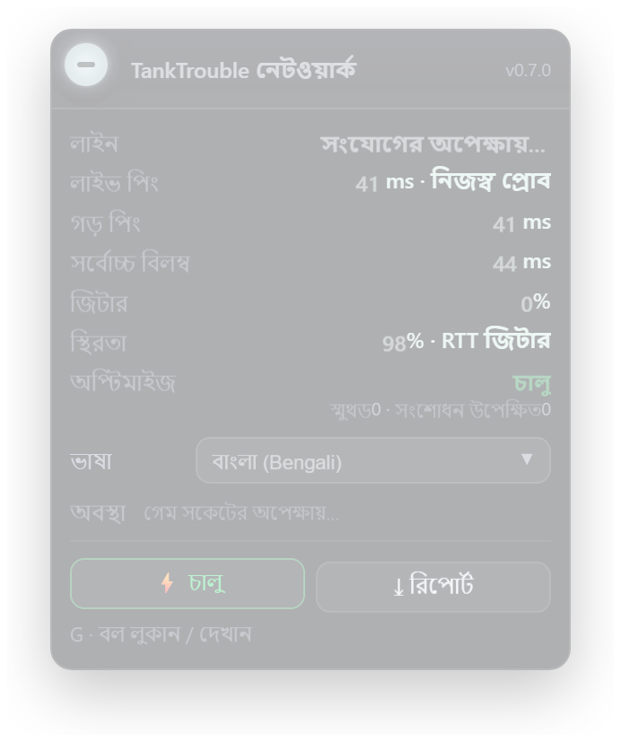
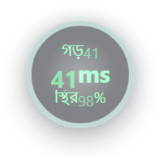

# 🇧🇩 TankTrouble নেটওয়ার্ক অপ্টিমাইজেশন

<p align="right"><sub>[🇬🇧 English](en.md) · [🇨🇳 中文](zh.md) · <b>🇧🇩 বাংলা</b> · [🇯🇵 日本語](ja.md) · [🇰🇷 한국어](ko.md) · [🇷🇺 Русский](ru.md) · [🇸🇦 العربية](ar.md) · [🇫🇷 Français](fr.md) · [🇪🇸 Español](es.md) · [🇩🇪 Deutsch](de.md) · [🇧🇷 Português](pt.md) · [🇻🇳 Tiếng Việt](vi.md)</sub></p>

 

> আরও সমৃদ্ধ, রিয়েল-টাইম ও নির্ভুল নেটওয়ার্ক প্রদর্শন — সাথে সত্যিকারের অপ্টিমাইজেশন।

**tanktrouble.com**-এর জন্য একটি Tampermonkey ইউজারস্ক্রিপ্ট: আপনার সংযোগ আসলে কেমন কাজ করছে তা দেখায়, এবং TCP head-of-line blocking-এর ফলে হওয়া “জমে যাওয়া → টেলিপোর্ট” সমস্যাটিকে মসৃণ স্লাইডে বদলে দেয়।

**কোনো সার্ভার নেই, নেটওয়ার্ক কনফিগারেশন নেই, VPN নয়।** সম্পূর্ণ ক্লায়েন্ট-সাইড — সার্ভার আগের মতোই হুবহু একই ডেটা পায়।

অপ্টিমাইজেশন শুধু *আপনি যা দেখেন* তা বদলায়: রেন্ডারের সময় অবস্থানটি স্মুথ করা হয়, কিন্তু গেম লজিক, ফিজিক্স ও সার্ভার ভ্যালিডেশন সবসময় আসল মান ব্যবহার করে। আপনার নিজের ট্যাংক লোকালভাবে authoritative, তাই রিকানেক্ট করলে আপনাকে পিছনে টেনে নেওয়া হবে না।

## এক-ক্লিক ইনস্টল · বৈশিষ্ট্য

| | |
|---|---|
| আরও সমৃদ্ধ | লাইন / গড় / লাইভ / সর্বোচ্চ / জিটার / স্টল / স্থিরতা, রিয়েল-টাইমে আপডেট |
| আরও রিয়েল-টাইম | প্রতি ২ সেকেন্ডে আলাদা ping প্রোব — ফ্রেম ইন্টারভাল নয়, আসল RTT |
| আরও নির্ভুল | আসল স্টল (head-of-line blocking) আর লবি/রাউন্ড-বিরতির নিষ্ক্রিয় সময় আলাদা করে দেখা যায় |
| সত্যিকারের অপ্টিমাইজেশন | রেন্ডার-টাইম স্মুথিং + লোকাল authoritative + dead reckoning, লাইভ A/B সুইচসহ |

## ⚠️ এটি একটি ইউজারস্ক্রিপ্ট — ব্রাউজার এক্সটেনশন নয়

প্রথমে **Tampermonkey** (ইউজারস্ক্রিপ্ট ম্যানেজার) ইনস্টল করুন। `chrome://extensions` / “Load unpacked” ব্যবহার **করবেন না**: একটি `.user.js` ফাইল Tampermonkey দিয়ে চলে, ব্রাউজার এক্সটেনশন হিসেবে ইনস্টল হয় না। পুরো কোডের পেজ দেখলে আপনি ভুল জায়গায় আছেন — এই টিউটোরিয়ালে ফিরুন।

## পদ্ধতি A — ডাউনলোড করা ফাইল Tampermonkey Dashboard-এ ড্র্যাগ করুন (প্রস্তাবিত, সবচেয়ে সহজ)

### ধাপ ১ (শুধু একবার) — Tampermonkey ইনস্টল করুন

Chrome/Edge: [Chrome Web Store](https://chromewebstore.google.com/detail/tampermonkey/dhdgffkkebhmkfjojejmpbldmpobfkfo) খুলে **Add to Chrome** চাপুন। Firefox: [addons.mozilla.org](https://addons.mozilla.org/firefox/addon/tampermonkey/) খুলে **Add to Firefox** চাপুন।

ইনস্টলের পর টুলবারে Tampermonkey আইকন না দেখলে: ব্রাউজারের উপরে ডানদিকের **পাজল/এক্সটেনশন** বাটনে ক্লিক করে Tampermonkey **পিন** করুন।

### ধাপ ২ — স্ক্রিপ্ট ফাইল ডাউনলোড করুন

**[⬇ Download](https://github.com/L-Shy-P/TankTrouble-Network-Optimization/raw/main/tanktrouble-netlab.install.user.js)**-এ ক্লিক করুন (বা নিচের লিংক খুলুন)। ব্রাউজার ফাইলটি **Downloads** ফোল্ডারে `tanktrouble-netlab.install.user.js` নামে সেভ করবে।

নাম বদলাবেন না, আনজিপ করবেন না, এডিট করবেন না — এটি সাধারণ টেক্সট স্ক্রিপ্ট।

```
https://github.com/L-Shy-P/TankTrouble-Network-Optimization/raw/main/tanktrouble-netlab.install.user.js
```

### ধাপ ৩ — Tampermonkey **Dashboard** খুলুন (বেশিরভাগ এখানেই আটকান)

ব্রাউজার টুলবারের **Tampermonkey আইকনে** ক্লিক করুন → পপআপ মেনুতে **Dashboard** ক্লিক করুন।

- আইকন না পেলে: **পাজল/এক্সটেনশন** বাটনে ক্লিক করে Tampermonkey-তে ক্লিক করুন।
- ⚠️ ওই মেনুর **Add new script** আইটেম **এডিটর** খোলে, ইনস্টল এন্ট্রি নয়। **Dashboard** ব্যবহার করুন (চীনা UI-তে “管理面板”)।
- অন্য Tampermonkey পেজে থাকলে বাঁদিকের সাইডবারে **Installed scripts** ক্লিক করে তালিকায় ফিরুন।

### ধাপ ৪ — ফাইলটি ভিতরে ড্র্যাগ করুন

**Dashboard তালিকা পেজ** খোলা রেখে **Downloads** ফোল্ডার থেকে `tanktrouble-netlab.install.user.js` ফাইলটি **Dashboard পেজের উপর** ড্র্যাগ করুন → Tampermonkey-এর ইনস্টল পেজ আসবে (গাঢ় পেজে স্ক্রিপ্টের নাম “TankTrouble Network Optimization”, ভার্সন ও **Install** বাটন) → **Install** চাপুন।

- ড্র্যাগ কাজ না করলে: **Dashboard → Utilities → Install from URL**-এ একই ডাউনলোড লিংক পেস্ট করে **Install** চাপুন।
- সরাসরি এক-ক্লিক লিংকও চাপতে পারেন (নিচে **পদ্ধতি B**): Tampermonkey থাকলে সোজা ইনস্টল পেজ খোলে। `// ==UserScript==` দিয়ে শুরু হওয়া কোডের পেজ দেখলে ক্লিকটি Tampermonkey-তে পৌঁছায়নি → এই ড্র্যাগ পদ্ধতিতে ফিরুন।

### ধাপ ৫ — গেম খুলুন

<https://tanktrouble.com/game> খুলুন → **Ctrl + F5** দিয়ে হার্ড-রিফ্রেশ করুন → উপরে বাঁদিকে প্যানেল বা ভাসমান বল দেখা যাবে। না দেখলে **Ctrl + Shift + L** চাপুন — হয়তো লুকানো আছে।

## পদ্ধতি B — এক-ক্লিক ইনস্টল (Tampermonkey আগে থেকেই থাকতে হবে)

[](https://raw.githubusercontent.com/L-Shy-P/TankTrouble-Network-Optimization/main/tanktrouble-netlab.user.js)

Tampermonkey ইনস্টল থাকলে ব্যাজে (বা নিচের লিংকে) ক্লিক করুন: Tampermonkey নিজের ইনস্টল পেজ খোলে — গাঢ় পেজে স্ক্রিপ্টের নাম “TankTrouble Network Optimization”, ভার্সন ও **Install** বাটন; **Install** চাপলেই স্ক্রিপ্ট ইনস্টল হয়। `// ==UserScript==` দিয়ে শুরু হওয়া পুরো কোডের পেজ দেখলে ক্লিকটি Tampermonkey-তে পৌঁছায়নি — **পদ্ধতি A**-তে ফিরুন।

```
https://raw.githubusercontent.com/L-Shy-P/TankTrouble-Network-Optimization/main/tanktrouble-netlab.user.js
```

## পদ্ধতি C — ডাউনলোড করা ZIP থেকে ইনস্টল (অফলাইন)

ড্র্যাগ-ইনস্টল জানলে **পদ্ধতি A-ই যথেষ্ট — ZIP দরকার নেই**। পুরো রিপোজিটরি অফলাইনে রাখতে চাইলে ZIP ব্যবহার করুন।

1. **ZIP ডাউনলোড করুন**

   [GitHub রিপোজিটরি](https://github.com/L-Shy-P/TankTrouble-Network-Optimization) খুলে **Code → Download ZIP** চাপুন।
2. **আনজিপ করুন**

   ZIP-টি সাধারণ ফোল্ডারে এক্সট্রাক্ট করুন (Windows: রাইট-ক্লিক → Extract All)।
3. **Tampermonkey ইনস্টল আছে কিনা নিশ্চিত করুন**

   না থাকলে পদ্ধতি A-এর ধাপ ১-এ ফিরুন। `chrome://extensions` ব্যবহার **করবেন না**।
4. **ইউজারস্ক্রিপ্ট লোড করুন**

   Tampermonkey আইকনে ক্লিক → **Dashboard**, তালিকা পেজ খুলে রাখুন, আনজিপ করা ফোল্ডার থেকে `tanktrouble-netlab.install.user.js` Dashboard পেজে ড্র্যাগ করুন, তারপর **Install** চাপুন। ড্র্যাগ কাজ না করলে **Dashboard → Utilities → Install from URL** ব্যবহার করুন।
5. **গেম রিফ্রেশ করুন**

   <https://tanktrouble.com/game> খুলুন (আগে খোলা থাকলে রিফ্রেশ করুন)। উপরে বাঁদিকে ভাসমান বল দেখা যাবে; তাতে ক্লিক করলে প্যানেল খুলবে।

`tanktrouble-netlab.user.js` একই স্ক্রিপ্ট; `install.user.js` শুধু ড্র্যাগ-অ্যান্ড-ড্রপ কপি, যাতে UTF-8 BOM আছে।

## স্ব-পরীক্ষা (তিনটি)

① **Dashboard** স্ক্রিপ্ট তালিকায় “TankTrouble Network Optimization” দেখাচ্ছে এবং টগল **ON**। ② `tanktrouble.com` পেজে Tampermonkey আইকনে নাম্বার ব্যাজ (**1**) দেখাচ্ছে। ③ **F12 → Console** চেপে `[TT NetLab vX.Y.Z] loaded...` দেখতে পাবেন।

## নতুনদের FAQ (বিভ্রান্ত হলে পড়ুন)

- **এটি কি Chrome এক্সটেনশন? chrome://extensions-এ যোগ করব?** — না। এটি একটি ইউজারস্ক্রিপ্ট। প্রথমে Tampermonkey ইনস্টল করুন; স্ক্রিপ্টটি Tampermonkey-এর ভিতরে ইনস্টল হয় — “Load unpacked” দিয়ে কখনও নয়।
- **Tampermonkey কী? দেখতে সন্দেহজনক অ্যাপের মতো।** — Tampermonkey হলো Chrome/Edge/Firefox-এর আদর্শ ইউজারস্ক্রিপ্ট ম্যানেজার, অফিসিয়াল স্টোর (tampermonkey.net) থেকে পাওয়া যায়। এই প্রকল্পটি GitHub-এ ওপেন সোর্স এবং এতে কোনো সার্ভার, VPN বা নেটওয়ার্ক সেটিংস লাগে না।
- **ZIP ডাউনলোড করেছি। পুরো আনজিপ করা ফোল্ডারটি ড্র্যাগ করব?** — না। Method A-তে ZIP-এর দরকারই নেই: শুধু `tanktrouble-netlab.install.user.js` ফাইলটি ডাউনলোড করুন (ধাপ ২) এবং Downloads ফোল্ডার থেকে শুধু সেই ফাইলটি Tampermonkey Dashboard-এ ড্র্যাগ করুন। পুরো ফোল্ডার স্ক্রিপ্ট নয়, ইনস্টল হবে না।
- **Tampermonkey Dashboard কোথায়, কীভাবে খুলব?** — ব্রাউজার টুলবারের **Tampermonkey আইকনে** ক্লিক করুন → **Dashboard**। আইকন না দেখলে পাজল/এক্সটেনশন বাটনে ক্লিক করে Tampermonkey পিন করুন। অন্য Tampermonkey পেজে থাকলে বাঁদিকের সাইডবারে **Installed scripts** ক্লিক করে তালিকায় ফিরুন। ⚠️ “**Add new script**” মেনু আইটেম ব্যবহার করবেন না — এটি এডিটর খোলে, ইনস্টল এন্ট্রি নয়।
- **“Add new script” চেপে এডিটর এসেছে — এটাই ইনস্টল এন্ট্রি?** — না। “Add new script” স্ক্রিপ্ট লেখার **এডিটর** খোলে; এখানে ইনস্টল হয় না। ইনস্টল এন্ট্রি হলো **Dashboard** তালিকা পেজ (“Installed scripts”): ডাউনলোড করা `tanktrouble-netlab.install.user.js` সেখানে ড্র্যাগ করুন, অথবা **Dashboard → Utilities → Install from URL**-এ গিয়ে `https://github.com/L-Shy-P/TankTrouble-Network-Optimization/raw/main/tanktrouble-netlab.install.user.js` পেস্ট করুন।
- **ডাউনলোড লিংকে কোডের পেজ দেখাচ্ছে / Chrome বলছে এই সাইট থেকে ইনস্টল করা যাবে না।** — Method A-এর জন্য এটি ঠিক আছে — লিংকটি শুধু ফাইল সেভ করার জন্য (Downloads ফোল্ডারে `tanktrouble-netlab.install.user.js` দেখুন)। তারপর ফাইলটি Tampermonkey **Dashboard** তালিকা পেজে ড্র্যাগ করুন। ফাইল ডাউনলোড না হলে লিংকে রাইট-ক্লিক → “Save link as…”, অথবা **Dashboard → Utilities → Install from URL** ব্যবহার করে একই লিংক পেস্ট করুন।
- **ফাইল ড্র্যাগ করেছি কিন্তু কিছু হচ্ছে না।** — ঠিক Tampermonkey **Dashboard** তালিকা পেজে (chrome://extensions বা সাধারণ ওয়েব পেজে নয়) ফেলুন, পেজটি খোলা ও সামনে রেখে। ড্র্যাগ-অ্যান্ড-ড্রপ ব্লক হলে **Dashboard → Utilities → Install from URL**-এ ডাউনলোড লিংক পেস্ট করুন।
- **ইনস্টল করেছি, কিন্তু গেমে কিছু দেখছি না।** — Ctrl+F5 দিয়ে গেম পেজ রিফ্রেশ করুন, Tampermonkey Dashboard-এ স্ক্রিপ্ট টগল ON কিনা দেখুন, এবং HUD দেখাতে Ctrl+Shift+L চাপুন। ইনস্টলের আগে খোলা পেজ রিফ্রেশ করতেই হবে।
- **ইনস্টলের পরে ZIP/ফোল্ডার কি রাখতে হবে?** — না। স্ক্রিপ্ট এখন Tampermonkey-এর ভিতরে থাকে; ZIP ও ফোল্ডার মুছে ফেলতে পারেন। পরে Tampermonkey থেকে বা raw লিংক দিয়ে আবার ইনস্টল করে আপডেট করবেন।
- **Tampermonkey-তে “Import from file” / “Add file” বাটন আছে — সেখানেই আপলোড করব?** — না। ওই বাটন Tampermonkey ব্যাকআপ `.zip` ফাইলের জন্য। এই স্ক্রিপ্ট ইনস্টল করতে Dashboard → Utilities → Install from URL ব্যবহার করুন, অথবা `.user.js` ফাইলটি Dashboard-এ ড্র্যাগ করুন।
- **`.user.js` ফাইলটি আবার rename/edit/unzip করতে হবে?** — না, ফাইলটি যেমন আছে তেমনই ব্যবহার করুন। ফাইলটিই স্ক্রিপ্টের টেক্সট; এটি chrome://extensions-এ দেবেন না এবং পুরো ফোল্ডার আপলোড করবেন না।
- **এক-ক্লিক ইনস্টল লিংক (Method B) চেপেছি — ইনস্টল হয়েছে?** — কাজ করলে **Tampermonkey নিজের ইনস্টল পেজ খোলে**: গাঢ় পেজে স্ক্রিপ্টের নাম “TankTrouble Network Optimization”, ভার্সন নম্বর ও **Install** বাটন দেখাবে — **Install** চাপলেই ইনস্টল হয়। যদি `// ==UserScript==` দিয়ে শুরু হওয়া পুরো কোডের পেজ দেখেন, বা ফাইল শুধু ডাউনলোড হয়, তাহলে ক্লিকটি Tampermonkey-তে পৌঁছায়নি: **Method A**-তে ফিরে ডাউনলোড করা `tanktrouble-netlab.install.user.js` **Dashboard** পেজে ড্র্যাগ করুন, অথবা **Dashboard → Utilities → Install from URL** ব্যবহার করুন।
- **সত্যিই ইনস্টল ও চালু হয়েছে কিনা নিশ্চিত করব কীভাবে?** — তিনটি যাচাই: ① Tampermonkey **Dashboard**-এর স্ক্রিপ্ট তালিকায় “TankTrouble Network Optimization” দেখাচ্ছে এবং টগল **ON**; ② `tanktrouble.com` পেজে Tampermonkey আইকনে নাম্বার ব্যাজ (**1**) দেখাচ্ছে; ③ **F12 → Console** চেপে `[TT NetLab vX.Y.Z] loaded...` লাইন দেখা যাচ্ছে। ③ না থাকলে আগে **Ctrl+F5** দিয়ে রিফ্রেশ করুন; তবুও না থাকলে স্ক্রিপ্ট বন্ধ বা অসম্পূর্ণ — **আবার ইনস্টল করুন**। ফাইলটি ১ম লাইন থেকে `// ==UserScript==` দিয়ে শুরু হতে হবে; `(function () {`-এর মতো মাঝখান থেকে শুরু হলে কাজ করবে না।

## হটকি

| কী | |
|---|---|
| `Ctrl+Shift+S` | নেটওয়ার্ক অপ্টিমাইজেশন চালু/বন্ধ (লাইভ A/B) |
| `Ctrl+Shift+L` | HUD লুকান / দেখান |
| `Ctrl+Shift+E` | ডায়াগনস্টিক রিপোর্ট এক্সপোর্ট (ক্লিপবোর্ডেও কপি) |
| `Ctrl+Shift+P` | ৭টি সার্ভার অঞ্চল পরীক্ষা করে র‍্যাঙ্ক করুন |
| `G` | ভাসমান বল লুকান / দেখান (আগের অবস্থা ফিরে আসে) |

প্যানেলের **⚡** বোতাম `Ctrl+Shift+S`-এর মতোই। প্যানেলে **১২টি ভাষা**র একটি বেছে নেওয়া যায়; ভাষা, অপ্টিমাইজেশন সুইচ ও ভাসমান বলের অবস্থান `localStorage`-এ সেভ থাকে।

## সমস্যা সমাধান

- **কিছুই দেখা যাচ্ছে না** — URL `*://*.tanktrouble.com/*`-এর সাথে মেলে কিনা ও স্ক্রিপ্ট চালু আছে কিনা দেখুন, তারপর `Ctrl+F5`।
- **প্যানেল উধাও** — `Ctrl+Shift+L` চাপুন। অবস্থান ও ভাঁজ করা অবস্থা মনে রাখা হয়।
- **এখনও আটকে যাচ্ছে** — এটি আপনার লাইনের সমস্যা, স্ক্রিপ্টের নয়। `Ctrl+Shift+E` দিয়ে রিপোর্ট এক্সপোর্ট করে প্যানেলে অঞ্চলগুলো তুলনা করুন।

## লিংক

* [রিপোজিটরি](https://github.com/L-Shy-P/TankTrouble-Network-Optimization) · [TECHNICAL.zh.md (চীনা)](TECHNICAL.zh.md)

<p align="right"><sub>[🇬🇧 English](en.md) · [🇨🇳 中文](zh.md) · <b>🇧🇩 বাংলা</b> · [🇯🇵 日本語](ja.md) · [🇰🇷 한국어](ko.md) · [🇷🇺 Русский](ru.md) · [🇸🇦 العربية](ar.md) · [🇫🇷 Français](fr.md) · [🇪🇸 Español](es.md) · [🇩🇪 Deutsch](de.md) · [🇧🇷 Português](pt.md) · [🇻🇳 Tiếng Việt](vi.md)</sub></p>
